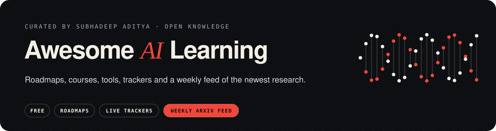
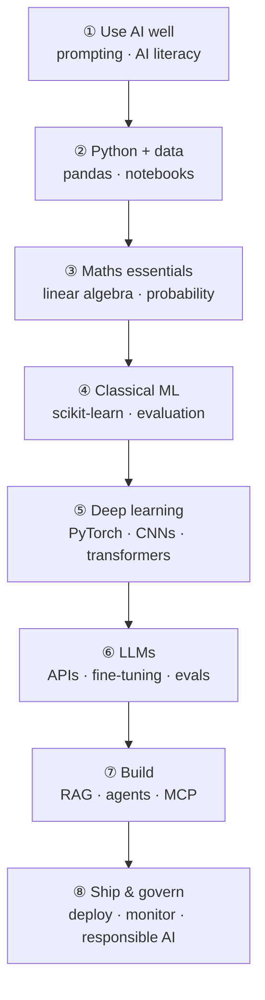

  
  
  
  
  

<b>Learn AI from zero to building agents — with free courses, the tools people actually use, and a live feed of what's new.</b> 
AI changes every week. This list is built to stay current: stable foundations below, fresh research in <a href="LATEST.md"><code>LATEST.md</code></a>, refreshed automatically every Monday.

---

## ⚡ Get the latest — every week, automatically

[`LATEST.md`](LATEST.md) is rebuilt by a GitHub Action every Monday with:

| Feed | Source |
|:--|:--|
| 🔥 **Trending papers** — what the community is upvoting | Hugging Face Daily Papers |
| 📄 **Newest research** in AI, machine learning, NLP and computer vision | arXiv |
| 🛠️ **Rising open-source AI repos** created in the last 30 days | GitHub |
| 🧬 **AI × biology & medicine** preprints | arXiv (q-bio + cs) |

**Live trackers to check any day**

- [LMArena leaderboard](https://lmarena.ai/leaderboard) — crowd-ranked chat, coding and vision models.
- [Artificial Analysis](https://artificialanalysis.ai) — independent benchmarks of quality, speed and price.
- [OpenRouter Models](https://openrouter.ai/models) — every major model, with context length and pricing.
- [Hugging Face Open LLM / trending models](https://huggingface.co/models?sort=trending) — what the open-weights world is downloading.
- [Papers with Code → Hugging Face Papers](https://huggingface.co/papers) — daily trending research.
- [Epoch AI — data on AI](https://epoch.ai/data) — compute, model and benchmark trends.
- [Stanford AI Index](https://hai.stanford.edu/ai-index) — the yearly state-of-AI report.

---

## Contents

- [Roadmap — from zero to AI engineer](#-roadmap--from-zero-to-ai-engineer)
- [Absolute beginners (no code)](#-absolute-beginners-no-code)
- [Maths for AI](#-maths-for-ai)
- [Machine learning](#-machine-learning)
- [Deep learning](#-deep-learning)
- [Large language models](#-large-language-models)
- [Prompting and context engineering](#-prompting-and-context-engineering)
- [AI agents and MCP](#-ai-agents-and-mcp)
- [RAG and vector search](#-rag-and-vector-search)
- [Tools and frameworks](#-tools-and-frameworks)
- [Free compute and datasets](#-free-compute-and-datasets)
- [AI for healthcare and life sciences](#-ai-for-healthcare-and-life-sciences)
- [AI governance, law and safety](#-ai-governance-law-and-safety)
- [Newsletters, podcasts and channels](#-newsletters-podcasts-and-channels)
- [Free certificates](#-free-certificates)

---

## 🗺️ Roadmap — from zero to AI engineer

| Weeks | Milestone | Build this |
|:--|:--|:--|
| 1–2 | AI literacy & prompting | A personal prompt library for your own work |
| 3–6 | Python & data | Clean and chart a public dataset (e.g. WHO, data.gov.in) |
| 7–10 | Classical ML | A classifier with a proper train/validation/test split |
| 11–16 | Deep learning | Fine-tune an image or text model in Colab |
| 17–20 | LLM apps | A RAG chatbot over your own notes or PDFs |
| 21–24 | Agents | A tool-using agent that completes a real multi-step task |

---

## 🌱 Absolute beginners (no code)

- [Elements of AI](https://www.elementsofai.com) — the classic free intro by the University of Helsinki.
- [AI for Everyone — Andrew Ng](https://www.coursera.org/learn/ai-for-everyone) — free to audit.
- [Anthropic Academy](https://anthropic.skilljar.com) — AI Fluency and Claude courses with free certificates.
- [OpenAI Academy](https://academy.openai.com) — workshops and guides for everyday and professional use.
- [Google — Introduction to Generative AI](https://www.cloudskillsboost.google/course_templates/536)
- [Microsoft Learn — AI training](https://learn.microsoft.com/en-us/training/)
- [IBM SkillsBuild — AI Fundamentals](https://skillsbuild.org)

---

## ➗ Maths for AI

- [3Blue1Brown — Essence of Linear Algebra](https://www.3blue1brown.com/topics/linear-algebra) and [Neural Networks](https://www.3blue1brown.com/topics/neural-networks)
- [Mathematics for Machine Learning (book, free PDF)](https://mml-book.github.io)
- [Khan Academy — Statistics & Probability](https://www.khanacademy.org/math/statistics-probability)
- [StatQuest](https://www.youtube.com/@statquest) — statistics and ML, clearly explained.
- [Seeing Theory](https://seeing-theory.brown.edu) — visual probability.

---

## 📈 Machine learning

- [Kaggle Learn](https://www.kaggle.com/learn) — short, hands-on, free certificates.
- [Google Machine Learning Crash Course](https://developers.google.com/machine-learning/crash-course)
- [Machine Learning Specialization — Andrew Ng](https://www.coursera.org/specializations/machine-learning-introduction) — free to audit.
- [Stanford CS229](https://cs229.stanford.edu) — the mathematically rigorous route.
- [scikit-learn user guide](https://scikit-learn.org/stable/user_guide.html)
- [An Introduction to Statistical Learning (free book, Python & R)](https://www.statlearning.com)
- [freeCodeCamp — Machine Learning with Python](https://www.freecodecamp.org/learn/machine-learning-with-python/)

---

## 🧠 Deep learning

- [fast.ai — Practical Deep Learning for Coders](https://course.fast.ai) — top-down, build-first.
- [MIT 6.S191 — Introduction to Deep Learning](https://introtodeeplearning.com) — refreshed every year.
- [Dive into Deep Learning (d2l.ai)](https://d2l.ai) — interactive book with code.
- [Deep Learning — Goodfellow, Bengio, Courville](https://www.deeplearningbook.org)
- [Understanding Deep Learning — Simon Prince](https://udlbook.github.io/udlbook/) — free, beautifully illustrated.
- [Stanford CS231n — Computer Vision](https://cs231n.stanford.edu)
- [PyTorch tutorials](https://pytorch.org/tutorials/)

---

## 💬 Large language models

- [Hugging Face LLM Course](https://huggingface.co/learn/llm-course) — transformers, fine-tuning, reasoning models.
- [Andrej Karpathy — Neural Networks: Zero to Hero](https://karpathy.ai/zero-to-hero.html) — build GPT from scratch.
- [Stanford CS224N — NLP with Deep Learning](https://web.stanford.edu/class/cs224n/)
- [Stanford CS336 — Language Modeling from Scratch](https://stanford-cs336.github.io)
- [mlabonne/llm-course](https://github.com/mlabonne/llm-course) — roadmap with notebooks.
- [The Illustrated Transformer — Jay Alammar](https://jalammar.github.io/illustrated-transformer/)
- [LLM Zoomcamp — DataTalks.Club](https://github.com/DataTalksClub/llm-zoomcamp)
- [Microsoft — Generative AI for Beginners](https://github.com/microsoft/generative-ai-for-beginners)

---

## ✍️ Prompting and context engineering

- [Anthropic prompt engineering guide](https://docs.claude.com/en/docs/build-with-claude/prompt-engineering/overview)
- [Anthropic interactive prompt tutorial](https://github.com/anthropics/prompt-eng-interactive-tutorial)
- [OpenAI prompting guide](https://platform.openai.com/docs/guides/prompting)
- [Google — Prompting guide for Gemini](https://ai.google.dev/gemini-api/docs/prompting-strategies)
- [Prompt Engineering Guide (DAIR.AI)](https://www.promptingguide.ai)

---

## 🤖 AI agents and MCP

- [Hugging Face AI Agents Course](https://huggingface.co/learn/agents-course) — free certificate.
- [Anthropic — Building effective agents](https://www.anthropic.com/engineering/building-effective-agents)
- [Model Context Protocol docs](https://modelcontextprotocol.io) — the open standard for connecting AI to tools and data.
- [MCP servers directory](https://github.com/modelcontextprotocol/servers)
- [DeepLearning.AI short courses](https://www.deeplearning.ai/short-courses/) — agents, RAG, evaluation, in about an hour each.
- [Microsoft — AI Agents for Beginners](https://github.com/microsoft/ai-agents-for-beginners)
- [LangChain Academy](https://academy.langchain.com) — LangGraph agents.

---

## 🔎 RAG and vector search

- [Pinecone Learning Center](https://www.pinecone.io/learn/)
- [Weaviate Academy](https://academy.weaviate.io)
- [LlamaIndex docs](https://docs.llamaindex.ai)
- [Sentence Transformers](https://www.sbert.net) — embeddings for search.
- [Chroma](https://www.trychroma.com) · [Qdrant](https://qdrant.tech) · [pgvector](https://github.com/pgvector/pgvector)

---

## 🛠️ Tools and frameworks

| Category | Tools |
|:--|:--|
| Assistants | [Claude](https://claude.ai) · [ChatGPT](https://chatgpt.com) · [Gemini](https://gemini.google.com) · [Perplexity](https://www.perplexity.ai) · [NotebookLM](https://notebooklm.google.com) |
| Coding with AI | [Claude Code](https://www.claude.com/product/claude-code) · [GitHub Copilot](https://github.com/features/copilot) · [Cursor](https://cursor.com) |
| Run models locally | [Ollama](https://ollama.com) · [LM Studio](https://lmstudio.ai) · [llama.cpp](https://github.com/ggml-org/llama.cpp) |
| Model hub | [Hugging Face](https://huggingface.co) |
| ML libraries | [PyTorch](https://pytorch.org) · [scikit-learn](https://scikit-learn.org) · [JAX](https://github.com/jax-ml/jax) · [Transformers](https://github.com/huggingface/transformers) |
| Fine-tuning | [Unsloth](https://github.com/unslothai/unsloth) · [TRL](https://github.com/huggingface/trl) · [Axolotl](https://github.com/axolotl-ai-cloud/axolotl) |
| Agents & orchestration | [LangGraph](https://github.com/langchain-ai/langgraph) · [CrewAI](https://github.com/crewAIInc/crewAI) · [smolagents](https://github.com/huggingface/smolagents) · [Claude Agent SDK](https://docs.claude.com/en/api/agent-sdk/overview) |
| Evals & observability | [promptfoo](https://github.com/promptfoo/promptfoo) · [Langfuse](https://github.com/langfuse/langfuse) · [Inspect (UK AISI)](https://inspect.aisi.org.uk) |
| Demos & UI | [Gradio](https://www.gradio.app) · [Streamlit](https://streamlit.io) |
| Data | [pandas](https://pandas.pydata.org) · [Polars](https://pola.rs) · [DuckDB](https://duckdb.org) |

---

## ☁️ Free compute and datasets

**Compute** — [Google Colab](https://colab.research.google.com) · [Kaggle Notebooks](https://www.kaggle.com/code) (free GPU/TPU hours) · [Hugging Face Spaces](https://huggingface.co/spaces) · [Lightning AI Studios](https://lightning.ai)

**Datasets** — [Hugging Face Datasets](https://huggingface.co/datasets) · [Kaggle Datasets](https://www.kaggle.com/datasets) · [UCI ML Repository](https://archive.ics.uci.edu) · [Google Dataset Search](https://datasetsearch.research.google.com) · [data.gov.in](https://data.gov.in) · [AI Kosh (IndiaAI)](https://aikosh.indiaai.gov.in)

---

## 🩺 AI for healthcare and life sciences

- [Stanford AIMI](https://aimi.stanford.edu) — AI in medicine and imaging, with open datasets.
- [PhysioNet](https://physionet.org) — clinical datasets incl. MIMIC (credentialed access).
- [MONAI](https://monai.io) — open-source medical imaging AI.
- [AlphaFold Server](https://alphafoldserver.com) · [ESM](https://github.com/evolutionaryscale/esm) · [Evo 2](https://github.com/ArcInstitute/evo2)
- [WHO — Ethics and governance of AI for health](https://www.who.int/publications/i/item/9789240029200)
- [Awesome Biotechnology](https://github.com/Subhadeep998/Awesome-Biotechnology) — companion list for biology.

---

## ⚖️ AI governance, law and safety

- [EU AI Act — official text & explorer](https://artificialintelligenceact.eu)
- [NIST AI Risk Management Framework](https://www.nist.gov/itl/ai-risk-management-framework)
- [OECD.AI Policy Observatory](https://oecd.ai)
- [IndiaAI Mission](https://indiaai.gov.in) · [MeitY](https://www.meity.gov.in)
- [UNESCO — Recommendation on the Ethics of AI](https://www.unesco.org/en/artificial-intelligence/recommendation-ethics)
- [AI Incident Database](https://incidentdatabase.ai)
- [BlueDot Impact — AI safety & governance courses](https://bluedot.org)
- [Anthropic Responsible Scaling Policy](https://www.anthropic.com/responsible-scaling-policy)

---

## 📬 Newsletters, podcasts and channels

- [The Batch — DeepLearning.AI](https://www.deeplearning.ai/the-batch/) — weekly, balanced.
- [Import AI — Jack Clark](https://importai.substack.com) — research and policy.
- [Ahead of AI — Sebastian Raschka](https://magazine.sebastianraschka.com) — LLM research explained.
- [Simon Willison's Weblog](https://simonwillison.net) — hands-on, daily.
- [Latent Space](https://www.latent.space) — podcast for AI engineers.
- [ThursdAI](https://thursdai.news) — weekly AI news show.
- [Two Minute Papers](https://www.youtube.com/@TwoMinutePapers) · [Yannic Kilcher](https://www.youtube.com/@YannicKilcher) · [Andrej Karpathy](https://www.youtube.com/@AndrejKarpathy)

---

## 🎖️ Free certificates

| Certificate | Provider |
|:--|:--|
| AI Fluency, Claude Code in Action and more | [Anthropic Academy](https://anthropic.skilljar.com) |
| AI Agents Course | [Hugging Face](https://huggingface.co/learn/agents-course) |
| Intro to ML, Intermediate ML, and more | [Kaggle Learn](https://www.kaggle.com/learn) |
| Machine Learning with Python | [freeCodeCamp](https://www.freecodecamp.org/learn/machine-learning-with-python/) |
| Elements of AI | [University of Helsinki](https://www.elementsofai.com) |
| NPTEL AI/ML courses (exam fee) | [NPTEL](https://nptel.ac.in) |

---

  <b>Found this useful?</b> ⭐ Star the repo · 🍴 Fork it · 👤 <a href="https://github.com/Subhadeep998">Follow @Subhadeep998</a> for more open knowledge. 
  Curated by <a href="https://subhadeep998.github.io">Subhadeep Aditya</a> — healthcare data analyst, researcher and author · Kolkata, India

